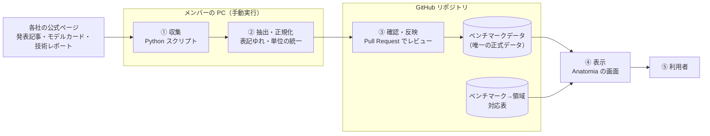

# Anatomia 企画書

> **位置づけ**：Anatomia が「誰の、どんな課題を、どう解くのか」に答える企画書\
> **確度**：**ドラフト（チームレビュー後・リーダー承認前）**\
> **R-1・R-2 の反映先**：§2-2・§2-4・§3-3・§4-3・§6-3・§8\
> **更新のしかた**：上書き（最新が正）\
> **最終更新**：2026-10-28（§4-3 の対象企業数の当て先〔手入力を含めた 8 社〕を決定にし、社数の見通しと OpenAI の数え方を R-3 とそろえた。§6-2 の画面を Streamlit に直し、§8 の Q-3 を解決した事項に移して Q-10 を立て、画面の担当を §7・§7-1 の 6 に足した。あわせて、§6-2 に、画面のコードは AI コーディングで作ってよいことを足した。対象モデル数と「モデルの数え方」は 2026-10-22 に直した）

> [!NOTE]
> **本文中の記号**
>
> - **【案】**：提案の段階で、チームでは未合意
> - **【未決】**：先生またはチームへの確認が必要な事項。§8 にまとめてある

---

## 0. 概要

| 項目 | 内容 |
| --- | --- |
| プロジェクト名 | Anatomia（アナトミア） — AIモデル分析ツール |
| 一言でいうと | 各AI企業が公表するモデルのベンチマークを集め、「どのモデルが、どの領域で強いか・弱いか」を1画面で比較できるWebツール |
| 位置づけ | 学校の授業の一環として行うプロジェクト |
| チーム | Cheers（§7） |

---

## 1. 背景

### 1-1. モデルを選ぶことが、利用者の仕事になった

- OpenAI（GPT）、Anthropic（Claude）、Google（Gemini）などが次々にモデルを公開している
- 利用者はモデルを直接ではなく、AIエージェント（コーディングエージェント、チャットアシスタントなど）経由で使うことが多い。多くのエージェントツールはモデルを切り替えられるため、**「どのモデルを使うか」の判断が利用者に委ねられている**

### 1-2. 判断材料はあるが、比較できる形になっていない

モデルの性能を示すベンチマークは各社から公表されている。しかし、利用者がそれを判断に使うまでには次の壁がある。

| 課題 | 具体的に起きていること |
| --- | --- |
| **散在している** | ベンチマークは各社の発表記事・モデルカード・技術レポートにばらばらに載っている。比較するには各社のサイトを巡回する必要がある |
| **揃っていない** | 各社で公表するベンチマークの種類・表記・測定条件（試行回数、ツール使用の有無、推論モードなど）が異なり、数値をそのまま並べられない |
| **何の能力か分かりにくい** | 「SWE-bench」「GPQA」などのベンチマーク名から、何の能力（コーディング、科学的推論など）を測っているかを読み取るには前提知識が要る |
| **すぐ古くなる** | 新モデルの公開サイクルが短く、調べた結果がすぐ古くなる。いつ時点の情報なのかも分かりにくい |

その結果、「結局どのモデルがどの領域で有用なのか」を知るのに手間がかかり、利用者は評判や慣れでモデルを選びがちになる（**仮説**。§5 の R-8 で検証する）。

### 1-3. 想定利用者

| 項目 | 内容 |
| --- | --- |
| 誰が | AIエージェントを使って開発や学習を行う人（まずは同じ学校の学生・エンジニア志望者を想定） |
| いつ使うか | 新しいモデルが公開されたとき／取り組むタスクに合ったモデルを選びたいとき |

---

## 2. テーマ決定

### 2-1. テーマ

> **AIモデルを領域ごとに「解剖」し、強みと弱みを1画面で見せる**

Anatomia はラテン語などで「解剖（学）」を意味する。モデルを一つの総合点で語るのではなく、領域ごとに分解して見せるというコンセプトを表す。

### 2-2. このテーマを選んだ理由

1. **課題が身近で、検証できる** — 私たち自身や同級生がAIエージェントを日常的に使っており、想定利用者に直接ヒアリングして課題を確かめられる
2. **授業の制約と解き方が噛み合う** — 必要なデータは各社が公表しており、Pythonスクリプトで集める対象になる。ただし、スクリプトで取れるかは取得元で変わる。自社サイトのままスクリプトで取れるのは Google だけで、他社は規約や公開形式（画像・ボット対策）に壁がある（[R-2 §1](research/r2-terms-robots.md)、[R-1 §3](research/r1-benchmark-formats.md)）。そこで、**どこから取るか（公式組織の Hugging Face の README など）の選び方が実現性を左右する**ものとして、取得元ごとに対象を決める（§5 R-3。取得元ごとの見通しは §4-3 の「社数の見通し」）。スクリプトで取れない値は、手入力で補う（§8 Q-1）。さらに、メンバーが手動で実行するという制約は、**取得した値を人が確認してから反映する工程**としてそのまま品質管理に使える
3. **小さく始めて広げられる** — 対象企業・ベンチマークを絞った最小構成から始め、企業・ベンチマーク・機能を段階的に増やせる

### 2-3. スコープ

#### やること（段階的に進める）

| 段階 | やること | 位置づけ |
| --- | --- | --- |
| **第1段階** | 各社が公式に公表したベンチマークスコアの収集（Pythonスクリプト・手動実行） | 必須。背景の課題に直接答える |
| **第1段階** | ベンチマークと領域（コーディング、数学など）の対応づけ | 必須 |
| **第1段階** | モデル×領域で強み・弱みを見られる一覧画面 | 必須 |
| **第1段階** | 全スコアへの出典URL・取得日・測定条件の表示 | 必須。信頼性の前提（§4-4） |
| 第2段階 | 価格（API料金）の収集と、コストパフォーマンスの表示 | README に記載。定義を R-6 で調査してから着手【案】 |
| 将来 | 用途に応じた最適なモデルのレコメンド | README に記載。第1・第2段階のデータが揃ってから検討 |

> **第2段階を後に回す理由【案】**：背景の課題（どの領域で強いか）に直接答えるのはベンチマークで、価格は比較の補助にあたる。また、公表されている価格は API の従量料金（トークン単価）が中心で、エージェント利用者の多くが払う月額料金とは単位が異なる。「コストパフォーマンス」を何で測るかを先に決めないと、誤解を招く表示になるおそれがある。

#### やらないこと

| やらないこと | 理由 |
| --- | --- |
| 自前でベンチマークを実行する | 計算資源・API費用がかかり、授業の範囲を超える。Anatomia の価値は「公表値の集約と整理」に置く |
| 定期的な自動クロール | 授業の制約（手動スクレイピング）。相手サイトへの負荷を最小限にする意味もある |
| 単一の総合スコアによる順位づけ | 測定条件の揃っていない数値を合算すると、実態と異なる優劣を示すおそれがある |
| 第三者機関のリーダーボードの値の取り込み | 対象を「各社が公表した値」に絞る。出典の性質が混ざると、比較の前提が崩れる |
| モデルを実際に使う機能（チャットなど） | 目的は比較・選定の支援で、利用は各社のツールで行う |

> **第三者機関のリーダーボードの位置づけ【案】**：値は取り込まないが、R-7 の調査や、公表値を確かめる参考として見るのはよい。食い違いに気づいたら出典ページを確認し直し、第三者の値で正式データを直したり、画面に並べたりはしない。

### 2-4. 「強い・弱い」の定義 — このツールの設計原則

各社は、自社モデルが良い結果を出したベンチマークを選んで公表する傾向がある。つまり**公表値だけでは「弱い領域」は直接には見えない**。そこで、次の4つを設計原則とする。

1. **「強い・弱い」は、同じベンチマークを公表したモデル同士の相対比較で示す**
2. **「未公表」と「低スコア」を区別して表示する。** 未公表を「弱い」とは扱わない
3. **測定条件が異なる値は、条件を明示して並べる。** 比較してよいかを利用者が判断できるようにする
4. **取り込むのは、各社が自社モデルについて公表した値だけ。** 置き場所（自社サイト・公式組織の Hugging Face）は問わない（[R-1 §4-1・§4-6](research/r1-benchmark-formats.md)）
    - Hugging Face の値は、公式組織の README.md に書かれた表から取る。Hub が表示する「Evaluation results」には第三者の PR で提案された値（`verified: false`）が混ざるので、使わない
    - 同じ会社の別モデルの値は取り込んでよい。他社モデルの値（比較表に並ぶ他社の列）は、取り込まない

---

## 3. ツールを実現するためのフロー

### 3-1. 全体像

### 3-2. 各工程

| # | 工程 | 内容 | 担い手 | 成果物 |
| --- | --- | --- | --- | --- |
| ① | 収集 | 各社の公式ページを Python スクリプトで取得する。**メンバーが手動で実行する。** まずスクリプトで取り（§6-3 でスクリプトでの取得が認められた取得元に限る）、スクリプトで取れない値（画像・PDF でしか公表されていない値、規約で自動での取得が禁止されたページの値、ボット対策で取れないページの値）だけを、メンバーがブラウザで見て手入力する（§8 Q-1） | メンバー | 取得したページ（確認用として実行者の手元にのみ保存） |
| ② | 抽出・正規化 | 取得したページからスコアを抽出し、ベンチマーク名の表記ゆれ（例：「SWE-bench Verified」と「SWE-Bench (Verified)」）や単位を統一する | Python スクリプト | 正式データへの更新差分 |
| ③ | 確認・反映 | 差分を**実行者以外のメンバー**が出典ページと照合し、一致を確かめてから正式データに反映する | メンバー | ベンチマークデータ（正式） |
| ④ | 表示 | 正式データと対応表から画面を生成する | Webアプリ | Anatomia の画面 |
| ⑤ | 利用 | 領域ごとの強み・弱みを見て、出典へ遡って確認する | 利用者 | — |

> **③で人の確認を挟む理由**：スクレイピングは、相手のページ構造が変わると誤った値を取り得る。手動実行の制約を活かし、**誤った値が画面に出る前に止める**。

### 3-3. データの持ち方

- **正式データはリポジトリ内の1箇所にだけ置く【案】。** 画面は正式データから生成し、画面側ではデータを持たない（同じデータを2箇所で管理すると、食い違いが起きたときにどちらが正しいか分からなくなるため）
- ベンチマーク→領域の対応表も同じ場所に置く。「このベンチマークをなぜこの領域に分類したか」の判断を1箇所で追えるようにする
- Git の履歴が、そのまま「いつ・誰が・何を更新したか」の記録になる

1件のスコアが持つ情報【案】：

| 項目 | 例 | なぜ必要か |
| --- | --- | --- |
| モデル名・提供企業 | （各社のモデル名） | 比較の単位 |
| 種類・推論モード | Reasoning／Instruct／Base、Non-Think／High／Max | 同じモデル名でも、種類・推論モードが違う値は、「モデル名＋種類＋推論モード」の組で区別して持つ。取得元の表の行の名前（例：Ministral 3 14B）だけで取ると、種類の違う値が1つにまとまる（[R-1 §4-7](research/r1-benchmark-formats.md)）。モデルを何個と数えるかは、これとは別に §4-3 で決める |
| ベンチマーク名 | SWE-bench Verified | 正規化後の名称で持つ。正規化で揃えるのは書き方（大文字小文字・ハイフン・空白・括弧の付け方・略記・提供元の名前）だけ（[R-1 §4-2](research/r1-benchmark-formats.md)の一覧に、括弧の付け方を加えた） |
| ベンチマークの版・種類 | 2.1／4.0、v2、Verified／Pro | 版や種類が違えば別のベンチマーク。同じモデルでも値が大きく違うので、名前を揃えて同じ列に並べない。名前に含めるか別の項目にするかは、R-4・R-5 で決める |
| スコア・単位 | 72.5（%） | 単位が混在する（小数・%・Elo）ので、単位を値と一緒に持つ（[R-1 §4-7](research/r1-benchmark-formats.md)） |
| 測定条件 | 1回の試行、ツール使用あり、Pass@1、ハーネス | 条件が異なる値を区別する（§2-4 原則3）。括弧内の指標やハーネスは、名前ではなくここに記録する |
| 出典URL | 各社のモデルカード・発表記事のURL | 利用者が一次情報へ遡れるようにする。実際に取ったページを書く |
| 取得日・取得者 | 2026-10-01・水戸 | 手動実行のため、いつ誰が取得した値かを追えるようにする |
| 取得方法 | スクリプト／手入力 | 手入力した値は、スクリプトでは取り直せない。再収集のときに区別する（§8 Q-1） |
| README の版（`sha`） | Hugging Face のリポジトリの `sha` | README は後から編集される。③の確認で、どの版の値かを特定できるようにする（Hugging Face から取った値のみ。[R-1 §4-1](research/r1-benchmark-formats.md)） |

手入力の値の持ち方【案】：スクリプトで取れない値（画像でしか公表されていない値など。§8 Q-1）は、次の形で持つ。

- **形式**：会社ごとの CSV（例：`data/manual/<会社>.csv`）。文字コードは UTF-8。表計算ソフトで入力でき、1 行が 1 件の値になる。JSON を手で書くと、カンマや引用符の書き間違いでファイル全体が壊れるため、入力のしやすさを優先する。この CSV は手入力のための入れ物で、正式データの形式（§6-2 の「JSON か CSV か」）とは別の話
- **どちらを正とするか**：手入力の値は CSV を正とする。正式データは CSV から作り直すだけで、手で直さない。照合で値を直すときも、反映の後に誤りが見つかったときも、CSV を直して作り直す（正式データが 2 か所で食い違わないようにする）
- **列**：1 行目（見出しの行）は、次をそのまま写す。会社ごとの CSV で見出しが変わらないようにするため。
  `モデル名,モデルの種類,推論モード,ベンチマーク名,ベンチマークの版・種類,スコア,単位,測定条件,出典URL,取得日,取得者,READMEの版(sha),備考`
  - 列は上の表の項目をもとにしている。表で 1 項目にしている「種類・推論モード」「スコア・単位」「取得日・取得者」は、CSV では別の列に分ける。「備考」は表にない列で、画像のどの位置か、などを書く。「種類」はモデルの種類（Reasoning／Instruct／Base）で、ベンチマークの種類とは別なので、「モデルの種類」と呼ぶ
  - モデルの種類・推論モードは、表と同じく、モデル名に混ぜずに別の列に書く。ベンチマークの版・種類は、名前に含めるか別の項目にするかが R-4・R-5 で決まる（上の表）まで、別の列に書いておく（どちらに決まっても、変換で名前に含められる）
  - `READMEの版(sha)` は、Hugging Face のモデルカードの画像から読んだ値のときだけ書く
  - 提供企業は列に持たず、ファイル名から取る。ファイル名の `<会社>` は、`scraper/` の出力の提供企業（`PROVIDER`。例：`Google`）と同じ綴りにする。綴りが違うと、変換の後に同じ会社が別の会社として並ぶため。「取得方法」は、読み込み時に `手入力` を自動で付ける
- **入力する人**：その会社の担当のメンバー（担当は §7-1 の 3・§8 Q-4 で決める。会社ごとの割り振りと、§7-1 の 3 の「モデルごと」の担当との関係も、そこで決める）
- **照合**：照合と、必須の項目（出典URL・取得日・取得者）は、§8 Q-1 の下の注の条件【案】に従う
- **読み込み**：CSV を、`scraper/` の出力（JSON。形は暫定）と同じ形に変換する部品は、別に作る（この案の対象外）

### 3-4. 画面イメージ【案】

モデルを行、領域を列にした一覧表を中心に置く。

| モデル | コーディング | 数学 | 科学的推論 | エージェント | … |
| --- | --- | --- | --- | --- | --- |
| モデルA | **強** | 中 | 未公表 | 強 | |
| モデルB | 弱 | **強** | 中 | 未公表 | |

- 企業・領域で絞り込める
- セルを選ぶと、その領域に含まれるベンチマーク別のスコア・測定条件・出典URLが表示される
- 公表値がない場合は、空欄にせず「未公表」と表示する（§2-4 原則2）
- 画面上に、データの最終取得日を常に表示する
- §4-4 の限界のうち、公表値が各社の自己申告であることを、画面上に常に示す
- 領域単位の「強・中・弱」の算出方法は【未決】（R-5 の結果で決める。§8 Q-6）

---

## 4. 有効性

### 4-1. 現状との比較

| 観点 | 現状（各社サイトを巡回） | Anatomia |
| --- | --- | --- |
| 情報を集める手間 | 企業ごとに発表記事・モデルカードを探して読む | 1画面で一覧できる |
| 比較のしやすさ | ベンチマークの種類・表記・条件が揃っていない | 表記を統一し、測定条件を並べて表示する |
| 何の能力かの理解 | ベンチマーク名から自分で調べる | 領域（コーディング、数学など）で整理されている |
| 情報の鮮度・信頼性 | いつ時点の情報か分かりにくい | 全スコアに取得日と出典URLがあり、一次情報へ1クリックで遡れる |

### 4-2. 既存サービスとの違い

モデルを比較するサービスは既に存在する（例：独自に測定した性能・価格・速度を比較する Artificial Analysis、人による対戦形式の投票でモデルを評価する Arena（旧 LMArena））。詳細は R-7 で調査する。

Anatomia の立ち位置【案】：

- **各社の公式公表値（一次情報）に絞り**、すべての値を出典へ遡れるようにする
- 公表値をもとに、**未公表を「弱い」と扱わずに、領域ごとの強み・弱みを見せる**（§2-4 原則2）。領域別の指標を出すサービスは既にあるため、「領域ごとに見せる」こと自体ではなく、公表値だけで作ることと、未公表と低スコアを区別することを違いとする
- 日本語で閲覧できる

> R-7 の結果、既存サービスとの差が小さいと分かった場合は、差別化の軸を見直す。

### 4-3. 成功の定義（第1段階）【案】

> 対象モデル数と数え方（下の「モデルの数え方」）、対象企業数の当て先（手入力を含めた企業数）は、リーダーが決めた。ほかの指標は【案】のまま。

| 指標 | 目標 | 測り方・根拠 |
| --- | --- | --- |
| 対象企業数 | 5社以上（手入力を含めた企業数に当てる。下の「社数の見通し」を参照） | 主要なモデル提供企業を一通り含み、比較として意味を持つ最低ライン。数え方は、**スクリプトで取得した企業**と、**手入力を含めた企業**を分けて書く。目標は手入力を含めた企業数（8 社）に当てる（対象モデル数と同じ。リーダーが 2026-10-28 に決めた。R-3 §4）。スクリプトで取得した企業（3 社）は別に書く |
| 対象企業の顔ぶれ | R-8 で利用者が使っていると答えた企業を、何割含むか（暫定。割合は R-8 の結果が出てから決める） | 社数だけでは、どの企業が入っていれば比較として意味を持つかが決まらない。利用者が実際に使う企業を含むことを基準にする。R-8 のヒアリング・アンケートで、使っているモデルの提供企業を聞く |
| 対象モデル数 | 15モデル以上（**手入力を含めた数**に当てる。スクリプトで取得した分（6 モデル）を別に書く。下の「モデルの数え方」を参照） | 各社の現行主力モデル。スクリプトで取れる企業は 3 社（Google・DeepSeek・Qwen）で、手入力を含めて 8 社になる。1 社あたり 1〜3 モデルで 15 になる内訳は R-3 §2-3 |
| 出典の付与率 | 全スコアの100% | 公表値の集約が価値の中心であり、出典の分からない値が1件でもあると信頼性が崩れる |
| 比較にかかる時間 | 各社サイト巡回の半分以下 | ユーザーテスト。課題（例：「数学が最も得意なモデルを、根拠つきで答える」）を、各社サイト巡回と Anatomia でそれぞれ解いてもらい時間を比べる。慣れの影響を分ける設計と人数は §4-5 |
| 分かりやすさ | 5段階評価で平均4以上 | ユーザーテスト後のアンケート |

#### 社数の見通し（R-2 §1 と §8 の Q-1・Q-8・Q-9 の扱いによる。R-3 §2-2 の内訳と同じ）

スクリプトでの取得だけでは、5 社に届かない。5 社以上にするには、手入力（§8 Q-1）が要る。

| 取り方 | 取れる企業 | 社数（累計） |
| --- | --- | --- |
| スクリプト（自社サイト） | Google | 1 |
| スクリプト（公式組織の Hugging Face のモデルカード。§8 Q-8） | ＋ DeepSeek・Qwen | 3 |
| 手入力（§8 Q-1） | ＋ Anthropic・xAI（§8 Q-9）、Meta、OpenAI、Mistral（主力モデル） | 8 |

- Mistral の Ministral 3 系は Hugging Face からスクリプトで取れるが小型モデルだけなので、含めず、社数にも数えない（R-3 §3 の 3。数えればスクリプトで 4 社になるが、その案は取らない）
- Anthropic・xAI は、§8 Q-9 で規約を守る側に倒したので、ページの形式によらずスクリプトの数には入れない

#### モデルの数え方

- **数える単位は「モデル名」にする。** 同じモデルの種類・推論モードの違い（DeepSeek-V4-Pro の Non-Think／High／Max、Ministral 3 14B の Reasoning／Instruct／Base）は、1 モデルと数える。「モデル名＋種類＋推論モード」の組（§3-3）で数えると、1 つのモデルが何件にも増え、15 は簡単に満たせてしまうため
- **「主力モデル」の基準**：各社が現行の主力として発表している、最新世代のモデル。**この文書には基準だけを書き、具体的なモデルは R-3 で決める**。対象モデル数（15）と、次の 3 点を含む数え方は、リーダーが 2026-10-22 に決めた。対象企業数の当て先（手入力を含めた 8 社）は、2026-10-28 に決めた（R-3 §3・§4）。チームの承認は、これを書いた PR（#31）の承認で取る
  - 世代の区切り：[R-1 §2](research/r1-benchmark-formats.md) の「最新の主力モデル」の列（2026-09-30 時点）にあるモデルだけを数える。列にないモデルは、同じカードの表に載っていても数えない。列が「など」で終わる企業（Google・OpenAI）も、列に名前のあるモデルだけを数える。足すときは、下の「見直し」で行う
  - サイズ違い：同じ系列のサイズ違い（例：Qwen3.8 系）は、1 モデルと数える
  - 小型モデルだけの系列：Ministral 3 系は含めない。Mistral は、主力モデルを手入力で数える

#### 見直し

- 数値目標（企業数・モデル数・顔ぶれの割合）は、**R-3 の完了時に 1 回**見直す（対象モデル数と対象企業数の当て先は、R-3 で見直した）。その時点で R-8 の結果が出ていなければ、顔ぶれの割合は **R-8 の完了時に**決める（決めるのはリーダー）
- 比較にかかる時間・分かりやすさの目標は、集められる人数やテストの設計で現実的な値が変わるので、**ユーザーテストの実施（§4-5 の「時期」）の前に**見直す
- 出典の付与率（全スコアの100%）は、信頼性の前提なので、見直しの対象にしない
- **見直しを決めるのは、リーダー**とする

### 4-4. 有効性の限界

以下は隠さずに画面上で示すことを、Anatomia の信頼性の前提とする。

- 公表値は各社の自己申告であり、第三者が検証した値ではない
- 各社は得意なベンチマークを選んで公表する傾向があり、弱みは「未公表」として現れやすい（§2-4）
- 手動更新のため、最新モデルの反映に遅れが出る

### 4-5. ユーザーテストの設計

§4-3 の「比較にかかる時間」「分かりやすさ」を測る方法。同じ人が同じ課題を2回解くと、2回目は答えを知っているので速くなる。「各社サイト巡回 → Anatomia」の順だと、Anatomia の効果と慣れの効果を分けられないため、次の形にする。

- **同じ人に、各社サイト巡回と Anatomia の両方を解いてもらう。** 難しさが同じくらいの別の課題（A・B）を2つ用意し、課題は全員 A → B の順に解いてもらう。方法の順番（各社サイト巡回が先か、Anatomia が先か）を、できるだけ半々に入れ替える（5人なら2人と3人）。こうすると、どちらの課題をどちらの方法で解くかも半々になり、課題の難しさの差が、一方の方法の時間に偏りにくい。別の人に方法ごとに解いてもらう形は、合計10人以上が要り、授業のチームと協力者の人数では集めにくいため採らない。時間は、方法の順番ごとの 2 つのグループで、方法ごとの平均を出してから、2 つのグループの平均をとって比べる（5人だと2人と3人に分かれ、全員の平均では課題の差が1人分残るため）
- **人数は、5人以上を目安とする**（R-8 のヒアリングの「5人以上【案】」にそろえる）。2〜3人の平均では、§4-3 の目標を満たしても根拠として弱いため、5人を下限の目安にする。協力者が5人に届かない場合は、§4-3 の「比較にかかる時間」「分かりやすさ」の目標を達成したかは判定せず、結果を「参考値」と明記して報告する。人数と判定の扱いは、設計を固めるとき（#22）に見直し、このままとした
- **時期**：設計は 10-21（5週）までに固め、実施は 7〜8週（11-04・11-11）に入れる想定

---

## 5. 調査項目

**優先度「高」は、結果次第で実現可能性や方針そのものが変わる項目。** 最初に着手する。

| ID | 調査項目 | 何のために調べるか | 調査方法 | 優先度 |
| --- | --- | --- | --- | --- |
| R-1 | 各社のベンチマークの公開形式（HTMLの表／画像／PDF／Markdown） | スクレイピングで取得できるかを判断する。**画像で公開された値はスクリプトで抽出できない**ため、対象企業の選定に直結する | 対象候補の公式ページを実際に確認し、形式を一覧にする | 高 |
| R-2 | 各社サイトの利用規約・robots.txt | スクレイピングが許容されているかを確認する。禁止されているサイトは対象から外す | 各社の利用規約・robots.txt を読む。判断に迷うものは先生に相談する | 高 |
| R-3 | 対象企業・モデルの選定 | 成功の定義（§4-3）を満たす対象を決める | R-1・R-2 の結果から取得可能な企業を選ぶ（候補：OpenAI、Anthropic、Google、Meta、xAI、Mistral AI、DeepSeek、Alibaba（Qwen）など） | 高 |
| R-4 | 主要ベンチマークの内容と領域の対応 | ベンチマークを領域に正しく分類する（対応表の根拠になる） | 各ベンチマークの論文・公式サイトで「何を測っているか」を確認する（候補：SWE-bench Verified、AIME、GPQA Diamond、MMMU、Humanity's Last Exam、τ²-bench など） | 中 |
| R-5 | 測定条件の違いと比較可能性 | 条件が異なる値の並べ方と、領域単位の「強・中・弱」の算出方法を決める | R-1 で集めたページの脚注・注記を比較する | 中 |
| R-6 | 価格情報の公開形式と「コストパフォーマンス」の定義 | 第2段階の設計に使う。何を「コスト」とするか（API料金か月額料金か）を決める | 各社の料金ページを確認する | 低 |
| R-7 | 既存サービス | Anatomia の差別化を確かめる | Artificial Analysis、Arena（旧 LMArena）など既存の比較サービスを実際に使って比べる | 中 |
| R-8 | 想定利用者のニーズ | 背景の仮説（「比較に手間がかかっている」「評判や慣れで選んでいる」）を確かめる | 同級生など AIエージェント利用者へのヒアリング・アンケート（5人以上【案】） | 中 |
| R-9 | 収集・表示の技術 | 実装方式を確定する | requests／BeautifulSoup（HTML）、Playwright（JavaScriptで描画されるページ）、pdfplumber（PDF）の検証、画面で使う表・グラフのライブラリの比較 | 中（R-1 の後） |

---

## 6. 環境条件

### 6-1. 制約条件

| 制約 | 内容 |
| --- | --- |
| 授業 | 本プロジェクトは学校の授業の一環として行う |
| スクレイピング | **Pythonスクリプトで、メンバーが手動で実行する。** 定期実行・自動実行はしない。メンバーが指示して AIエージェントに実行させる場合も、手動での実行に含める（スクレイピングの体験に数えるかは、次の行）。このとき、§6-3 の「取得者」には、指示したメンバーを記録する。ただし、§6-3 の例外として行う robots.txt の確認は、指示があってもエージェントには実行させず、メンバーが自分でスクリプトを実行する（§6-3 の条件どおりに取ったかを、人が確かめられるようにするため） |
| スクレイピングの体験 | 授業の目的の一つが、スクレイピングを体験することなので、**メンバー全員が、各自少なくとも 1 回、自分の手でコマンドを打って取得スクリプトを実行する。** 取得のたびに全員が実行するわけではない。**AIエージェントに実行させたものは、この 1 回に数えない。** 体験のために実行する取得元も、§6-3 でスクリプトでの取得が認められたものに限る（取得元ごとの判定は R-2 §1）。上の行でエージェントの実行を手動での実行に含めるのは、定期実行・自動実行をしないという制約と、取得者の記録についての扱いで、体験の代わりにはならない。授業の目的は、授業での先生の口頭の説明による（説明の日付は記録していない。シラバスなどの文書の出典は確かめていない）。この行の方針（各自少なくとも 1 回・エージェントの実行は数えない）は、2026-10-07 に水戸がチームで合意済みと報告し、#13 のレビューで、鈴木は問題なしとし、蒲山は止めるべき問題はないとした。この行の方針と、§7-1 の 3 の「実行者」の数え方は、#16 の承認をもって、チームの合意とした。各自の実行結果の照合は §7-1 の 3 |

### 6-2. 開発環境【案】

| 区分 | 内容 | 理由 |
| --- | --- | --- |
| 収集 | Python 3（バージョンはチームで固定）、requests、BeautifulSoup。必要に応じて Playwright、pdfplumber | 授業の制約。ライブラリは R-9 で確定する |
| データ | JSON または CSV ファイルをリポジトリで管理する | データ量は数百件程度の見込みで、データベースを立てる必要がない。Git の履歴が更新記録になる |
| 画面 | Streamlit（Python） | 画面まで Python だけで書ける。収集側と同じ言語なので、読み書きとレビューを同じ知識でできる。この行は §8 Q-3 で決まった（ほかの行は【案】のまま）。データは手動でしか更新されないため、画面は正式データのファイルを読んで表示するだけにする |
| バージョン管理 | Git／GitHub | Pull Request で③の確認を行い、更新履歴を残す |

> **収集と表示を分ける理由**：Python（収集）と Webアプリ（表示）は、**データファイルの形式だけを約束事としてやり取りする。** この約束事（JSON か CSV か、§3-3 の項目）は最初に固定し、収集と表示を並行して進められるようにする。どちらかを作り直しても、もう一方に影響しない。また、Webアプリからは一切スクレイピングしないので、手動実行の制約とも矛盾しない。画面は Streamlit で、収集と同じ Python・同じリポジトリになるが、画面のコードは収集のコード（`scraper/`）を呼ばず、正式データのファイルだけを読む。
>
> **Next.js を選ばなかった理由**：Next.js + TypeScript は、チームが別プロジェクト（YSE Compass）で使っているので学習コストは低いと見ていた。ただし、授業外の作業時間が限られるメンバーがいて、Compass の作業とも時間がぶつかるため、画面は Python だけで書ける Streamlit にした。画面の自由度が下がることは受け入れる。
>
> **画面のコードと AI コーディング**：画面（Streamlit）のコードは、AI コーディング（AI エージェントにコードを書かせること）で作ってよい。授業の目的の一つはスクレイピングの体験で（§6-1）、このプロジェクトの本質は収集にあり、画面は収集した結果を見せる手段のため。AI が書いたコードも、ほかの変更と同じく PR でレビューを受ける（§7-1 の 2）。収集のコード（`scraper/`）での AI の扱いは、この合意に含めない。2026-10-28 に水戸（画面の担当）が出した案で、**#35 の承認をもって、チームの合意とする。**

### 6-3. スクレイピングの実行ルール【案】

| ルール | 理由 |
| --- | --- |
| robots.txt と利用規約で禁止されていない範囲でのみ取得する | R-2 の結果に従う。「許可されていない」ではなく「禁止されている」かで線を引く。法的な判断ではなく、規約の文面を読んだ整理（R-2 §6） |
| 「要相談」「不可」のサイト（R-2 §1。Hugging Face から取る企業の自社サイトも、自社規約が自動での取得や抽出を禁止しているので含める。R-2 §3-1）には、調査や検証でもスクリプトでアクセスしない（規約ページはブラウザで確認する。値が要るときは、ブラウザで見て手入力する。§8 Q-1）。「要相談」のサイトも、「不可」と同じに扱う（Anthropic・xAI は §8 Q-9 で規約を守る側に倒した。Meta は R-2 §4 のとおり Q-1 の手入力で扱う）。**ただし robots.txt の確認は除く**（取得の可否を確かめる標準の手順。間隔を空けて、1 回ずつ取る）。このルールは、§6-3 が【案】の間も、企画書（main）に入った時点から適用する（アクセスを控える側のルールのため） | 取得でなくても、規約が禁止する「スクリプトでのアクセス」にあたるおそれがあるため（R-2）。先生の説明（§8 の「先生の説明と、解決の根拠」）は、サイトのルールを守ることを制約にしていて、これらのサイトへのスクリプトでのアクセスを認めたものではない。R-1・R-2 の調査は、このルールを企画書に入れる前に行った（R-1 は、要相談・不可のサイトのページも、JavaScript 実行前の生 HTML を 1 回ずつ取得して判定している。R-1 冒頭の調査方法） |
| リクエストの間隔を3秒以上空ける | 相手サーバーへの負荷を避けるため。相手がどれだけの負荷に耐えられるかは外から分からない。図書館サイトへの自動アクセスが業務妨害を疑われ、逮捕に至った事例（2010年・岡崎市立中央図書館事件。起訴猶予）では、アクセスは1秒に1回程度だった※ |
| 403・429、ボット判定の画面が返ったら、そのサイトでの取得を止める。制限を回避しない | 回避は、相手の意思に反するアクセスになるため（OpenAI がこの例。[R-1 §3](research/r1-benchmark-formats.md)） |
| Hugging Face からは、各社が自分の公式組織で公開しているモデルカード（README.md）に限り、`hf_hub_download` などで取得する（自社サイトからは取らない。§8 Q-8）。取得を始める前に、取得するリポジトリの License に、取得を制限する条件がないかを確かめる（確かめ済みのリポジトリと未確認のものは R-2 §3-3）。間隔のルールと、403・429・ボット判定で止めるルールも同じく適用する | 詳細は [R-2 §5](research/r2-terms-robots.md)。License の確認は、R-2 §4 の質問 A の文面（各モデルカードの License の条件も確認する）による |
| 取得するのは数値（スコア）と出典情報に限り、記事本文はリポジトリに含めず公開もしない | 他者の著作物の再配布を避けるため |
| 取得日・取得者をデータに記録する | 手動実行のため、いつ誰が取得した値かを追えるようにする |
| 取得結果は実行者以外のメンバーが確認してから反映する | ページ構造の変化で誤った値を取り得るため（§3-2 ③） |

※ 図書館側のソフトウェアに、1時間に400以上（平均9秒に1回にあたる）のリクエストを送られると他の処理ができなくなる不具合があったと報じられている（毎日jp 2010-08-22。以下の Wikipedia の記述による）。出典：[岡崎市立中央図書館事件（Wikipedia）](https://ja.wikipedia.org/wiki/%E5%B2%A1%E5%B4%8E%E5%B8%82%E7%AB%8B%E4%B8%AD%E5%A4%AE%E5%9B%B3%E6%9B%B8%E9%A4%A8%E4%BA%8B%E4%BB%B6)、[はてなニュース](https://hatenanews.com/articles/201009/1696)

### 6-4. 利用環境【案】

| 項目 | 内容 | 理由 |
| --- | --- | --- |
| 端末 | PC の Webブラウザ（Chrome・Edge などの最新版）を主な対象とする | モデル×領域の一覧表は横幅を必要とするため。スマートフォンは閲覧できる程度に留める |
| 公開範囲 | Web ツール（比較画面）は、メンバーの PC のローカルサーバーだけで動かし、公開しない（発表時も同じ）。ほかの端末（LAN を含む）からのアクセスは考えない。リポジトリは公開のままで、データ（数値と出典）は公開リポジトリに入る。Web ツールを公開しないことは、2026-10-14 にリーダー（蒲山）が述べ、#23 の承認をもって、チームの合意とした | リポジトリを公開にしているので、取得した数値と出典は公開される（§6-2 の「JSON または CSV ファイルをリポジトリで管理する」）。記事の本文は入れない（§6-3）。Web ツールを公開しないのは、公開を控える側の決定なので、先生の回答を待たずにチームで決める。この公開（データ）と各社の規約との関係は【未決】（R-2 §5、§8 Q-2）。収集（取得）の可否の判断（R-2 §1）は、公開しなくても変わらない |
| 更新頻度 | 週1回の確認＋新モデル公開時 | 手動実行の負担と情報の鮮度の釣り合いをとる |

---

## 7. チーム体制

チーム名：**Cheers**

| 役割 | 氏名 |
| --- | --- |
| リーダー | 蒲山 由梨花 |
| サブリーダー | 鈴木 和明 |
| メンバー | 水戸 匠 |

画面の担当は水戸（2026-10-28 に決定。§8 Q-3）。収集・調査など、ほかの担当の割り振りは【未決】（§8 Q-4）。

### 7-1. チーム方針

**1. 進め方**

- 毎朝の授業開始時に、リーダーが 10 分ほど Briefing を行い、作業の進捗確認と今日の作業指示をする（授業の指定）
- 企画書が基準になる。企画から外れないよう、変更したときは、変更した人（PR の作成者）が、マージ後の最初の Briefing で変更点をチームに共有する

**2. 変更の入れ方**

- 企画書・調査を含め、リポジトリへの変更は、すべて Pull Request で行い、作成者以外のメンバー 1 人以上がレビューして承認してから、作成者が main にマージする
- レビュー・承認・マージには、各自の AI エージェント（Claude Code など）を使ってよい。エージェントが出した承認・マージは、エージェントに許可したメンバーの承認・マージとして扱う（許可できる場合と、エージェントが確かめることは `AGENTS.md` の禁則 8 が正）
- 承認後にコミットを足したときは、足した人がその PR でお知らせし、承認し直してもらう。意味が変わらない修正（誤字・リンク・表記のゆれ）も同じ。main のブランチ保護で、コミットを足すと古い承認が外れ、最後に push した人以外の承認が要るように設定する（設定の値の正は GitHub。この行は設定の根拠）

**3. データの確認**

- スクリプトで取得した値は、実行者以外のメンバーが出典ページと照合してから、正式データに反映する（§3-2 ③）
- **モデルごとの取得の担当【案】**：取得は、モデルごとに担当のメンバーを決めて行う。担当のメンバーが、そのモデルの値をスクリプトで取得し、担当以外のメンバーが、その値を出典ページと照合（レビュー）する。担当以外のメンバーが取得した値は、正式データに入れない。担当のモデルを自分の手で取得すれば、その実行は §6-1 の「スクレイピングの体験」の「各自少なくとも 1 回」にあたる。確定のしかたは §8 Q-4
- 「実行者」は 1 回の実行ごとに数える。エージェントに実行させたときは、指示したメンバーを実行者とする（§6-1 の「取得者」と同じ）。メンバーどうしの出力を見比べるだけでは、照合にしない（同じスクリプトの誤りは、全員の出力に同じように出るため。照合は出典ページと行う）
- 割り振り（誰がどのモデルを担当し、誰がその値を照合するか）と、同じモデルで照合を通った値が複数あるとき（担当が取り直したときなど）・照合で食い違ったときに、どの値を入れるかは【未決】（§8 Q-4）

**4. 判断と記録**

- 先生・チームへの確認事項は §8 に ID をつけて集める。決まった内容は企画書に反映する
- 根拠のあるものと、確かめていないものを分けて書く。確かめたものは、誰がどう確かめたかも書く（例：R-1 の「レビューでの確認」「作成者のブラウザでの確認」）

**5. アクセスのルール**

- サイトへのアクセスのルール（要相談・不可のサイトの扱いを含む）は、§6-3 に従う（R-2 の結果）。文面は §6-3 を正とし、ここには書き写さない

**6. 役割と参加**

- 授業の趣旨（アクティブラーニング）に沿って、リーダー任せにしない。レビューや調査は、メンバーで分担する
- 画面以外の担当の割り振りは【未決】（§8 Q-4）。画面の担当は水戸（§8 Q-3）。レビューを全員が担当する形にするかも、Q-4 とあわせて決める

**7. 連絡**

- 日々の連絡は Slack、リポジトリに入れないメモの共有は Notion、課題（調査・PR）の管理は Linear を基本とする。決まったこと（企画書の変更・先生への確認事項）は、Slack や Notion に残すだけで終わらせず、企画書（§8 を含む）に反映する

---

## 8. 未決事項と解決した事項

| ID | 事項 | 確認先 | 関連 |
| --- | --- | --- | --- |
| Q-2 | 公開リポジトリに置くデータ（数値と出典）と、各社の規約との関係（Web ツールは公開しない。§6-4） | 先生 | R-2、§6-4 |
| Q-4 | 担当の割り振り（画面の担当は Q-3 で決まった。画面以外について、レビューを全員が担当する形にするか、どのモデルを誰が取得し、誰がその値を照合するかを含む）。あわせて、同じモデルで照合を通った値が複数あるとき・照合で食い違ったときに、どの値を正式データに入れるかを決める。モデルごとの取得の担当（§7-1 の 3【案】）は、R-3 で対象モデル数が決まった後に、リーダーがこの Q-4 として、形（1 人が何モデルを持つか、全員に割り振れるか）を含めて確定する | チーム（リーダー判断） | §6-1、§7、§7-1 の 3 |
| Q-5 | スケジュール（授業の日程・発表日に合わせて作成する） | 先生・チーム | §4-5 |
| Q-6 | 領域単位の「強・中・弱」の算出方法（決める条件：§2-3 で総合スコアを避けた理由を、領域の中でも満たすこと。領域の中のベンチマークも測定条件や単位が違い、合算すると同じ問題が起きるため） | チーム | §2-3、§2-4、§3-4、R-5 |
| Q-7 | 第2段階（コストパフォーマンス）を授業期間内に含めるか | チーム（リーダー判断） | §2-3、R-6 |
| Q-10 | Python のバージョンと、正式データの形式（JSON か CSV か）・置き場所の確定。収集と画面が約束事としてやり取りする部分（§6-2 の「収集と表示を分ける理由」） | チーム（リーダー判断） | §3-3、§6-2、`docs/setup.md` |

**解決した事項**（ID は、ほかの文書から参照されているので残す）

| ID | 事項 | 決まったこと | 反映先 |
| --- | --- | --- | --- |
| Q-1 | スクリプトで取得できない値の扱い（画像・PDFでしか公表されていない値や、ボット対策・規約のために自動では取得できないページの値。手入力を認めるか、対象外とするか） | 手入力してよい。手順（まずスクリプトで取り、取れない値だけを手入力する）は §3-2 ①、条件は下の「手入力の条件」 | §3-2 ①、§4-3、§6-3 |
| Q-3 | 技術スタックの確定（当時の §6-2 の案〔Next.js〕か、Streamlit などの代替案か） | 画面は Streamlit（Python）で作り、水戸が担当する。リーダー（蒲山）が決め、水戸と鈴木も合意した（2026-10-28、授業開始時のブリーフィングでの口頭。蒲山が報告し、#32 のレビューで水戸が確かめた）。収集側のライブラリ（Playwright など）は R-9 で、Python のバージョンとデータの形式は Q-10 で確定する | §6-2、§7、§7-1 の 6 |
| Q-8 | 【質問 A】Hugging Face の整理（DeepSeek・Qwen・Mistral） | 各社が自分の公式組織で公開している Hugging Face のモデルカードに限り、自社サイトの代わりにスクリプトで取得してよい。License の確認を含む取得の条件は §6-3 | §4-3、§6-3 |
| Q-9 | 【質問 B】消費者向け規約の適用範囲（Anthropic・xAI） | 先生に個別には聞かない。規約を守る側に倒し、Anthropic・xAI の自社サイトにはスクリプトでアクセスせず、値は手入力（Q-1）で扱う | §4-3、§6-3 |

> **先生の説明と、解決の根拠**：2026-10-07 の授業での先生の口頭の説明による（文書の出典は確かめていない。2026-10-21 に水戸が報告）。この授業の課題は「自分たちでテーマを決めて情報収集して成果を教えて」というもので、方法はチームが決めてよい。先生から出ている制約は、「サイトのルールを守ること」と「授業の一環なので、お金がかかることはしないこと」の 2 つだけである。説明では、手入力（スクリプトで取れない値を手で書き写すこと）と、Hugging Face から取ること（Q-8）にも触れていた。この説明は、方法の許可ではなく課題の枠組みなので、Q-1・Q-8 の扱いはチームで決める。**Q-1・Q-8 の扱い（表の「決まったこと」の列）は、#25 の承認をもって、チームの合意とする。** 下の「手入力の条件」【案】は、この合意に含めない。Q-9 の扱いは、水戸が使う AI エージェントの案を、水戸が確かめて採用した（2026-10-07）。先生に個別には聞かず、先生の制約の「サイトのルールを守ること」を、規約が及ぶかがはっきりしない場合は及ぶ側に倒して当てはめたもの（R-2 §3-2 の判定と同じ前提）。
>
> **Q-8・Q-9 の質問の文面は、R-2 §4 を正とする**（このファイルには ID・見出し（対象の企業）と、決まったことだけを書く。文面が2か所に分かれるのを防ぐため）。

> **手入力の条件【案】（Q-1）**：反映の前に、入力した人以外のメンバーが出典と照合する（§3-2 ③と同じ）。出典URL・取得日・取得者は、スクリプトで取得した値と同じく必須とし、手入力した値であること（「取得方法」の項目）もデータに記録する（§3-3）。
